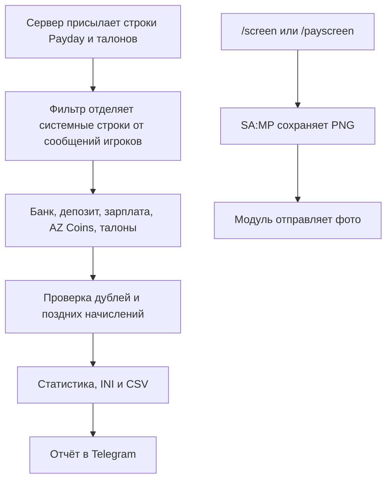

# Arizona Payday Clean

**MoonLoader-скрипт для Arizona RP: сам считает каждый Payday, показывает, когда окупится ранг, и присылает отчёт в Telegram, пока игра свёрнута.**

[English](README.md) · Русский · [Қазақша](README.kk.md)

**[Скачать последний релиз](https://github.com/artyom129/Arizona-Payday-Clean/releases/latest)**

## Что он делает

Купил ранг, оставил персонажа в AFK и свернул игру. Дальше скрипт сам отвечает на вопросы, ради которых обычно разворачивают окно: сколько пришло за Payday, какой был множитель, сколько уже вернулось за ранг и сколько ещё ждать.

- читает строки Payday с сервера и отделяет их от сообщений игроков, так что чужой текст в чате не подделает банк или зарплату
- ведёт общую статистику, статистику сессии и историю в CSV
- считает окупаемость ранга с учётом множителя x2, x3, x4 и, по желанию, депозита
- показывает банк, депозит, AZ Coins и талоны
- шлёт отчёт в Telegram после каждого Payday и отвечает на команды бота, включая свежий скриншот игры по `/screen`
- восстанавливает статистику из резервных копий
- обновляется через GitHub Releases с проверкой SHA-256 и откатом
- работает в свёрнутой игре и корректно закрывается вместе с ней

| | |
| --- | --- |
| Платформа | MoonLoader, SA:MP, Arizona RP |
| Основной файл | `ArizonaPaydayClean.lua` (кодировка CP1251) |
| Настройки | `moonloader/config/ArizonaPaydayClean.ini` |
| История | `moonloader/config/ArizonaPaydayHistory.csv` |

## Возможности

**Статистика.** Payday определяется автоматически: банк и депозит, зарплата и доход с депозита за последний Payday, AZ Coins и талоны, число Payday, общий доход, текущая сессия. Повторный учёт исключён, поздние начисления дописываются в уже созданную запись.

**Окупаемость.** Номер и цена ранга, зарплата x1, множитель определяется сам. Видно, сколько вернулось, сколько осталось денег и Payday и примерно сколько это по времени. Мини-окно держит прогресс на экране.

**Интерфейс.** Главное окно на `mimgui` с разделами «Банковский чек», «Окупаемость», «Telegram», «Аналитика» и «Обновления», компактное мини-окно, сохранение настроек, текстовые поля для больших сумм.

**Telegram.** Отчёт после Payday, тестовое сообщение, команды бота, доступ только для сохранённого `chat_id`, асинхронная очередь запросов. Никаких `curl.exe`, PowerShell, CMD и других внешних процессов.

## Что нового

**2.0.28.** Новый вид окна. Графитовые поверхности и один янтарный акцент, который остаётся за деньгами, прогрессом и активным разделом. Спокойная боковая панель вместо ярко-оранжевых кнопок, крупные цифры в карточках банка и депозита, заголовки без капса. Логика учёта не менялась. Эта версия лежит в репозитории; в архив релиза она попадёт после проверки в игре.

**2.0.27.** Контроль пропущенного Payday ждёт первый подтверждённый Payday текущего запуска. Защита от дублей устойчива к переводу системных часов назад. Проверка резервной копии INI проходит по всем полям, даже если часть из них пропала. Отправка в Telegram и `getUpdates` не делят один транспорт. Строки CSV нормализуются перед записью. Поля ранга работают как предпросмотр до нажатия «Сохранить».

Полная история в [CHANGELOG.md](CHANGELOG.md).

## Установка

Нужны GTA San Andreas, SA:MP или сборка Arizona RP, MoonLoader, `mimgui`, `lib.samp.events` и `inicfg`.

1. Закрой GTA.
2. Скачай архив [последнего релиза](https://github.com/artyom129/Arizona-Payday-Clean/releases/latest).
3. Скопируй `ArizonaPaydayClean.lua` в `moonloader/`.
4. Скопируй `lib/ArizonaPaydayScreen.dll` в `moonloader/lib/`. Он нужен для `/screen`; без него учёт Payday работает, а скриншоты нет.
5. Оставь в `moonloader` одну копию скрипта, иначе две версии посчитают один Payday дважды.
6. Не удаляй `ArizonaPaydayClean.ini` и `ArizonaPaydayHistory.csv` в `moonloader/config/`.
7. Запусти игру и открой окно командой `/payday`.

`/payupdate` дальше обновляет Lua-файл сам. DLL ставится вручную один раз.

## Команды в игре

| Команда | Что делает |
| --- | --- |
| `/payday`, `/paycalc` | Открыть или закрыть окно |
| `/paystats` | Статистика текущей сессии |
| `/payhistory` | Последние записи Payday |
| `/payrecover` | Восстановить данные из резервных копий и CSV |
| `/paydebug` | Диагностический лог |
| `/paywatch` | Контроль пропущенного Payday |
| `/paymini`, `/paymini on`, `/paymini off` | Мини-окно |
| `/payscreen` | Скриншот игры в Telegram |
| `/paytg TOKEN CHAT_ID` | Сохранить токен бота и chat ID |
| `/paytgtest` | Тестовый отчёт |
| `/paytgon`, `/paytgoff` | Включить или выключить уведомления |
| `/paybot` | Включить или выключить команды бота |
| `/paytgcommands` | Обновить меню команд бота |
| `/payupdate`, `/payupdate rollback` | Обновиться или вернуть прошлую версию |

Пример: `/paytg 1234567890:AAExampleBotTokenExample 123456789`. Для группы или канала `chat_id` бывает отрицательным, например `-1001234567890`.

## Команды бота

| Команда | Что делает |
| --- | --- |
| `/start`, `/help` | Справка |
| `/status`, `/ping` | Состояние игры, Payday и последней строки сервера |
| `/stats` | Общая статистика |
| `/today` | Статистика за сегодня |
| `/screen` | Свежий скриншот игры |
| `/rank` | Окупаемость ранга |
| `/history N` | Последние Payday |
| `/watch` | Состояние контроля Payday |
| `/settings` | Текущие переключатели |
| `/version` | Установленная версия |

Управлять персонажем через Telegram нельзя. Токен и `chat_id` хранятся только локально в `moonloader/config/ArizonaPaydayClean.ini`, в публичном файле скрипта их нет.

После Payday в Telegram приходят зарплата, множитель, доход с депозита, общий доход, баланс банка и депозита, AZ Coins, талоны, прогресс окупаемости и время последней строки сервера.

## Как это устроено

- **Без внешних процессов.** Текст и обновления идут через встроенный асинхронный `downloadUrlToFile` MoonLoader.
- **Изолированные скриншоты.** `ArizonaPaydayScreen.dll` получает токен только на время одной отправки. Если модуля нет или Telegram отклонил фото, страдает только этот запрос, статистика не затрагивается.
- **Без дублей.** Сервер шлёт связанные строки через Chat, GameText и TextDraw. Скрипт собирает их в коротком окне, сверяет сигнатуры и дописывает поздние начисления в текущий Payday.
- **Большие суммы.** Значения больше 32-битного `InputInt` вводятся текстом и аккуратно переводятся в числа.
- **Чистый выход.** При `/q` окно закрывается, новые запросы не создаются, задача скриншота отменяется, состояние сохраняется один раз.

## Если что-то не так

Открой Issue и приложи: что произошло и после чего, была ли игра свёрнута, был ли anti-AFK, включены ли уведомления и команды бота, какие ещё скрипты работали, последние строки `moonloader/moonloader.log` и пример серверной строки, которую скрипт понял неправильно. Если `gta_sa.exe` закрылся без ошибки Lua, загляни в «Просмотр событий Windows → Журналы Windows → Приложение».

Не прикладывай `ArizonaPaydayClean.ini`, временные JSON-ответы Telegram, архив `moonloader/config` и скриншоты с токеном.

## Автор и лицензия

[Koncha Artyom](https://github.com/artyom129). Лицензия [MIT](LICENSE): пользуйся, меняй и распространяй, сохраняя упоминание автора.
